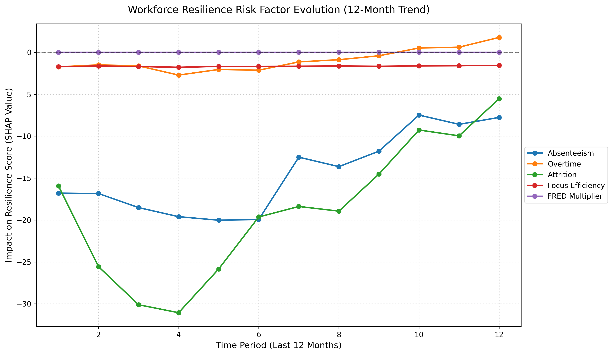

# Labor Resilience Framework

## Project Overview

The **Labor Resilience Framework** is a standardized, industry-agnostic analytical engine designed to quantify, diagnose, and forecast workforce stability. By bridging the gap between localized HR telemetry (absenteeism, overtime dependency, attrition) and broad macroeconomic indicators, this framework provides enterprise leadership and policy architects with a rigorous, data-driven approach to human capital risk management. 

At its core, the framework calculates a composite **Resilience Score**—a normalized metric that identifies systemic vulnerabilities before they cascade into operational failures. Coupled with an interactive simulation suite and interpretability layers, organizations can run sophisticated scenario analyses to model recovery trajectories against a backdrop of dynamic economic conditions.

---

## National Interest & Policy Relevance

In an era defined by rapid labor market shifts and unpredictable economic shocks, workforce stability is a critical component of national economic security. This framework addresses critical vulnerabilities in the U.S. labor market by:

*   **Forecasting Labor Shortages:** By structurally evaluating the leading indicators of burnout (e.g., productivity-adjusted overtime) and disengagement (absenteeism), the model forecasts localized labor shortages, allowing for preemptive strategic interventions.
*   **Contextualizing Macro-Economic Shocks:** The health of an organizational workforce does not exist in a vacuum. By integrating live macroeconomic telemetry (e.g., national unemployment trends), the framework contextualizes internal performance against systemic, nation-wide pressures, providing a realistic assessment of recovery difficulty during periods of economic volatility.
*   **Establishing Adaptability Standards:** As a standardized framework, it enables consistent benchmarking across diverse sectors (from Manufacturing to Healthcare), fostering a data-driven dialogue on labor market adaptability and resilience standards for 2026 and beyond.

---

## Core Features

### 1. Composite Resilience Scoring
Translates multi-dimensional workforce behavior into a unified `Resilience Score` (0-100). The mathematical engine standardizes metrics against domain-specific risk thresholds and applies intelligent penalty weights to assess operational fragility.

### 2. Intelligence Layer (Macro-Economic Integration)
Breaks down data silos by dynamically pulling live telemetry from federal institutions. 
*   **FRED API:** Fetches the current U.S. Unemployment Rate (Series: UNRATE) to act as a systemic stability buffer or friction multiplier during scenario simulations.
*   **BLS API:** Interfaces with the Bureau of Labor Statistics to establish true industry baselines (e.g., Average Weekly Overtime for Manufacturing), enabling precise Z-Score normalizations for individual organizations.

### 3. SHAP Interpretability & Driver Drift
Utilizes SHapley Additive exPlanations (SHAP) to unpack the "black box" of the composite score. 
*   **Risk Attribution:** Precisely isolates the primary driving factor of score degradation (e.g., identifying that Attrition contributed -18 points).
*   **Trend Analysis (Driver Drift):** Evaluates longitudinal data to identify whether a specific risk factor is becoming a systemic, structural threat over time, outputting automated narrative summaries for leadership.

### 4. Recovery Velocity & Simulation
An optimization engine that allows architects to simulate strategic interventions (e.g., targeted overtime reduction, focus efficiency training, headcount expansion). 
*   **Recovery Velocity:** Quantifies the month-over-month impact of active interventions.
*   **Timeline Estimation:** Projects the exact number of months required to reach a target Resilience Score, applying mathematical friction penalties if the model is operating under "Pandemic Mode" or severe economic stress.

---

## Technical Architecture

The repository is modularly structured to support rapid scaling, API integration, and integration into existing enterprise data pipelines:

*   `core_engine/`: Contains the foundational mathematical models (`resilience.py`), Z-Score normalizers, and productivity-adjustment logic.
*   `intelligence_layer/`: API wrapper classes (`fred_integration.py`, `bls_fetcher.py`) utilizing `python-dotenv` for secure, external data ingestion.
*   `interpretability/`: Houses the `ResilienceExplainer`, utilizing `shap` and `matplotlib` to generate mathematical transparency and visual trend evaluations.
*   `optimization/`: Contains the `WorkforceSimulator` for forecasting scenario impacts and generating strategic, rules-based recommendations.
*   `app.py`: A comprehensive `Streamlit` dashboard providing an interactive, front-end interface for executing real-time economic stress tests and visualizing recovery trajectories.

---

## Getting Started

### Prerequisites
*   Python 3.8+
*   *(Optional but Recommended)* A [FRED API Key](https://fred.stlouisfed.org/docs/api/api_key.html) and a [BLS API Key](https://data.bls.gov/registrationEngine/) for live intelligence layering.

### Installation

1. **Clone the repository:**
   ```bash
   git clone https://github.com/your-username/labor-resilience-framework.git
   cd labor-resilience-framework
   ```

2. **Install dependencies:**
   ```bash
   pip install -r requirements.txt
   ```

3. **Configure Environment Variables:**
   Create a `.env` file in the root directory and add your API keys:
   ```env
   FRED_API_KEY=your_fred_api_key_here
   BLS_API_KEY=your_bls_api_key_here
   ```

### Execution

**Generate Synthetic Data (For Testing):**
Creates 15,000 records simulating Healthcare, Retail, and Manufacturing workforces.
```bash
python examples/generate_data.py
```

**Run SHAP Trend Analysis:**
Evaluates Driver Drift over the synthetic time-series and exports a visualization chart.
```bash
python examples/run_trend_analysis.py
```

**Launch the Interactive Dashboard:**
Starts the Streamlit application for scenario simulation and economic stress testing.
```bash
streamlit run app.py
```

---

## Sample Images




---
## Disclaimer
This project is provided "As Is" without any warranties of any kind. The authors and contributors assume no responsibility for the accuracy, reliability, or completeness of the output generated by this framework. End users are solely responsible for validating and interpreting the output before making any business or economic decisions.
---
